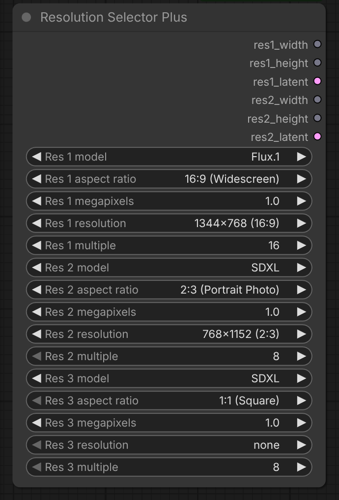
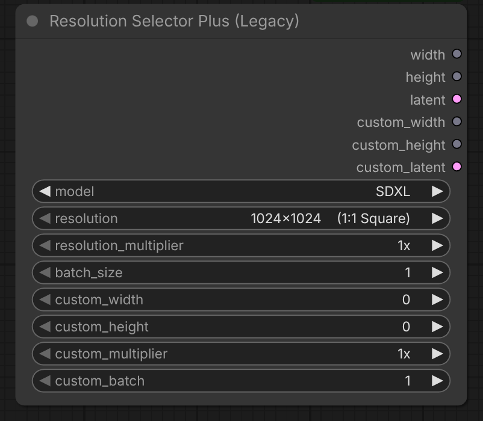

# Resolution Selector Plus - Custom node for ComfyUI

Custom node for [ComfyUI](https://github.com/comfyanonymous/ComfyUI) providing easy resolution and empty latent selection for image generation workflows.



## Features

- **Resolution Selector Plus:** pick a named aspect ratio and megapixels, then choose from matching resolutions.
- **Up to four resolution slots:** each active slot has width, height, and empty latent outputs.
- **Per-slot model and rounding multiple:** choose a discovered ComfyUI image model and pixel multiple independently for each slot.
- **Resolution Selector Plus (Legacy):** existing model presets and custom dimensions remain available for saved workflows.

## Installation

### ComfyUI Manager (recommended)

In ComfyUI, open **Manager > Custom Nodes Manager**, search for **ComfyUI_ResolutionSelectorPlus**, click **Install**, then restart ComfyUI.

### Manual install

```bash
# Change to the directory you installed ComfyUI
cd pathTo/ComfyUI

# Change to the custom_nodes directory
cd custom_nodes

# Clone the repo into custom_nodes
git clone https://github.com/bradsec/ComfyUI_ResolutionSelectorPlus.git

# Restart ComfyUI
```

## Usage

### Resolution Selector Plus

**Add Node:** `Add Node > utils > Resolution Selector Plus`

The internal node IDs remain `ResolutionSelectorPlusV2` and `ResolutionSelectorPlus` for saved workflow compatibility.

Each slot has these controls. Slot 1 is required; slots 2 through 4 appear as you activate preceding slots.
The node displays names such as "Res 1 model" and "Res 2 aspect ratio"; workflow input IDs remain `resN_model` and `resN_aspect_ratio`.
Resolution labels are compact, for example `1280x704 (16:9)`, with no orientation text.

| Input | Choices and default | Meaning |
| --- | --- | --- |
| `res1_model` through `res4_model` | Image models discovered from installed ComfyUI; default SDXL | Sets each slot's latent channels, spatial downscale, and tensor shape. Released model labels remain valid in saved workflows. |
| `res1_aspect_ratio` through `res4_aspect_ratio` | 1:1 (Square), 5:4 (Large Format), 4:3 (Standard), 3:4 (Portrait Standard), 3:2 (Photo), 2:3 (Portrait Photo), 16:10 (Widescreen Monitor), 5:8 (Portrait Widescreen Monitor), 16:9 (Widescreen), 9:16 (Portrait Widescreen), 2:1 (Univisium), 1:2 (Portrait Univisium), 21:9 (Ultrawide), 12:5 (Cinemascope), 5:12 (Portrait Cinemascope), 3:1 (Panorama), 1:3 (Portrait Panorama); default 1:1 (Square) | Filters each slot's resolution list. |
| `res1_megapixels` through `res4_megapixels` | 0.25, 0.5, 1.0, 1.5, 2.0, 4.0; default 1.0 | Filters each slot's resolution list. |
| `res1_resolution` through `res4_resolution` | Up to three base candidates near 90%, 100%, and 110% of target area. Each target snaps to 64 pixels; if its result has a different labeled ratio, it retries at 32, 16, then 8 pixels. Duplicate candidates appear once. Slot 1 defaults to the first 1:1, 1.0 MP candidate; later slots default to `none`. | Selects a base resolution. |
| `res1_multiple` through `res4_multiple` | 8, 16, 32, 64; default 8 | Rounds that slot's width and height to the nearest multiple, with half values rounded up and a minimum of one multiple. |

The dropdown reads `comfy.supported_models.models` at startup. A bundled ComfyUI v0.44.0 snapshot supplies choices when ComfyUI cannot be imported. Changing a slot's `resN_model` sets its `resN_multiple` to the best multiple below. You can change it afterward; saved overrides remain on reload. If it is smaller than that model's latent downscale, latent dimensions use integer division and the node logs a note.

| Model | Channels | Downscale | Best multiple |
| --- | ---: | ---: | ---: |
| SD 1.5 | 4 | 8 | 8 |
| SDXL | 4 | 8 | 8 |
| SD3 | 16 | 8 | 16 |
| Flux.1 | 16 | 8 | 16 |
| Flux.2 | 128 | 16 | 16 |
| Chroma | 16 | 8 | 16 |
| Z-Image | 16 | 8 | 16 |
| Qwen-Image | 16 | 8 | 16 |
| Qwen-Image 2.1 | 64 | 16 | 16† |
| HiDream | 16 | 8 | 16 |
| HunyuanImage 2.1 | 64 | 32 | 32† |
| Flux.3 | 128 | 16 | 16† |
| MOSS-Image | 128 | 16 | 16† |
| Ideogram 4 | 128 | 16 | 16† |
| Krea 2 | 16 | 8 | 16 |
| Anima | 16 | 8 | 16 |
| JoyImage | 16 | 8 | 16 |
| AuraFlow | 4 | 8 | 16 |
| Boogu | 16 | 8 | 16† |
| Chroma Radiance | 3 | 1 | 16† |
| Cosmos Predict2 | 16 | 8 | 16 |
| ERNIE-Image | 128 | 16 | 16† |
| FIBO 2 | 128 | 16 | 16† |
| Flux.1 Schnell | 16 | 8 | 16 |
| HiDream-O1 | 3 | 1 | 32 |
| Hunyuan-DiT | 4 | 8 | 16 |
| Kandinsky 5 Image | 16 | 8 | 16† |
| Lens | 128 | 16 | 16† |
| LongCat-Image | 16 | 8 | 16 |
| Lumina Image 2.0 | 16 | 8 | 16 |
| Mage Flow | 128 | 16 | 16 |
| Ming-Image | 16 | 8 | 16† |
| OmniGen2 | 16 | 8 | 16 |
| PixArt-Alpha | 4 | 8 | 16 |
| PixArt-Sigma | 4 | 8 | 16 |
| PixelDiT | 3 | 1 | 16 |
| SenseNova U1.5 | 3 | 1 | 32 |
| KOALA | 4 | 8 | 8 |
| SD 2.x | 4 | 8 | 8 |
| SSD-1B | 4 | 8 | 8 |
| Segmind Vega | 4 | 8 | 8 |
| Other (4ch /8) | 4 | 8 | 8 |

† Medium confidence from ComfyUI source; checkpoint patch sizes may vary. Models not in this table use the smallest of 8, 16, 32 or 64 that is at least their latent downscale.

Maintenance: a model is listed when its ComfyUI class has a 2D latent, or is in the 3D image allowlist (`INCLUDE_3D` in `model_discovery.py`), and is not in `EXCLUDE`. After a ComfyUI update, review new classes in `comfy.supported_models` and add non-image ones to `EXCLUDE`, 3D image models to `INCLUDE_3D`. Every label in this table stays selectable even if the installed ComfyUI no longer has its class (filled from `model_snapshot.json`), so saved values do not vanish. Unknown classes use their raw class name as the label.

Set `res2_resolution` beyond `none` to reveal its output triple and the next selector. Repeat through res4. Setting an earlier slot to `none` clears later slots and their links. Saved workflows retain active slot selections and links.
Older workflows with bare aspect ratios migrate to named values on load. If saved widget values are invalid or shifted, the frontend restores defaults and warns once. API prompts with bare ratios such as `16:9` also validate. Python still rejects unknown ratios.

When KJNodes is installed, right-click Resolution Selector Plus and select **Auto Set nodes (KJNodes): Off** to turn it on. This optional setting creates one collapsed SetNode beside each active output and removes managed SetNodes when their slot deactivates or the setting is turned off. **Set node prefix...** adds an optional prefix, with an underscore inserted when needed. For example, `portrait` names the first SetNode `portrait_res1_width`. Existing SetNode names take precedence; managed names get a numeric suffix on a clash. Both settings and managed node IDs save with the workflow. Workflows saved with these SetNodes show missing nodes if KJNodes is later uninstalled.

| Slot | Outputs |
| --- | --- |
| 1 | `res1_width` (INT), `res1_height` (INT), `res1_latent` (LATENT) |
| 2 | `res2_width` (INT), `res2_height` (INT), `res2_latent` (LATENT) |
| 3 | `res3_width` (INT), `res3_height` (INT), `res3_latent` (LATENT) |
| 4 | `res4_width` (INT), `res4_height` (INT), `res4_latent` (LATENT) |

Outputs are named `res1_width`, `res1_height`, `res1_latent`, through `res4_latent`.

**Examples:**

```text
Resolution Selector Plus (res1_model: SD3, res1_aspect_ratio: "16:9 (Widescreen)", res1_megapixels: 1.0,
  res1_resolution: "1344x768 (16:9)")
  -> res1_latent -> KSampler

Resolution Selector Plus (res1_model: SDXL, res1_aspect_ratio: "1:1 (Square)", res1_megapixels: 1.0,
  res1_resolution: "1024x1024 (1:1)", res2_model: Qwen-Image 2.1,
  res2_aspect_ratio: "9:16 (Portrait Widescreen)", res2_megapixels: 0.5,
  res2_resolution: "512x896 (9:16)")
  -> res1_width / res1_height / res1_latent for the square branch
  -> res2_width / res2_height / res2_latent for the portrait branch
```

## Resolution Selector Plus (Legacy)



The legacy node remains available for saved workflows. Its inputs and six outputs work as before. Use Resolution Selector Plus for new workflows.

**Add Node:** `Add Node > utils > Resolution Selector Plus (Legacy)`

**Inputs:**
- `model` (dropdown) - Select an installed image model or "All" for all resolutions. Existing names and presets remain; newly discovered models list the All presets that their best multiple divides.
- `resolution` (dropdown) - Choose from model-optimized presets with aspect ratios (e.g., "1920x1080 (16:9 Landscape)")
- `resolution_multiplier` (dropdown) - Multiply preset resolution (1x, 2x, 3x, 4x)
- `batch_size` (number) - Number of latent samples to generate (1-64, default: 1)
- `custom_width` (optional) - Override with custom width (0-4096, step 8)
- `custom_height` (optional) - Override with custom height (0-4096, step 8)
- `custom_multiplier` (optional) - Independent multiplier for custom dimensions (1x, 2x, 3x, 4x)
- `custom_batch` (optional) - Number of latent samples for custom resolution (1-64, default: 1)

**Outputs:**
- `width` (INT) - Preset resolution width in pixels
- `height` (INT) - Preset resolution height in pixels
- `latent` (LATENT) - Empty latent tensor for preset resolution (batch_size samples)
- `custom_width` (INT) - Custom width (0 if not set)
- `custom_height` (INT) - Custom height (0 if not set)
- `custom_latent` (LATENT) - Empty latent tensor for custom resolution (custom_batch samples)

**Example Workflows:**

**Basic preset with multiplier:**
```
Resolution Selector Plus (Legacy) (model: SDXL, resolution: "1024x1024    (1:1 Square)", resolution_multiplier: 2x)
  -> width: 2048, height: 2048
  -> latent -> KSampler
```

**Custom dimensions with independent multiplier:**
```
Resolution Selector Plus (Legacy) (custom_width: 1024, custom_height: 768, custom_multiplier: 2x)
  -> custom_width: 2048, custom_height: 1536
  -> custom_latent -> KSampler
```

**Using "All" model option:**
```
Resolution Selector Plus (Legacy) (model: All, resolution: "1920x1080    (16:9 Landscape)")
  -> Shows all 76 unique resolutions from all models
```

---

## Compatibility

Dual API: exports the legacy V1 `NODE_CLASS_MAPPINGS` and a V3 `comfy_entrypoint` (`comfy_api`). Verified on ComfyUI 0.25.0. On builds whose loader reads `NODE_CLASS_MAPPINGS` first, the V1 path is used and `comfy_entrypoint` is skipped, so nodes are not registered twice.

## Support

If you find this useful, please consider [starring the repo](https://github.com/bradsec/ComfyUI_ResolutionSelectorPlus). Stars help other people discover these nodes.
